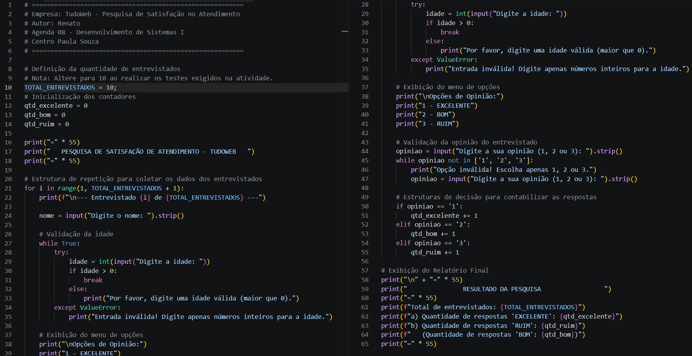
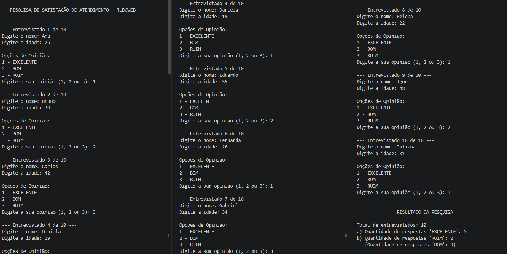

# Agenda 08 - Pesquisa de Satisfação de Atendimento (TudoWeb)

**Curso:** Técnico em Desenvolvimento de Sistemas (EAD) — Centro Paula Souza  
**Disciplina:** Desenvolvimento de Sistemas I  
**Autor:** Renato Hiroshi Sato  

---

## 📌 Descrição do Projeto
Atividade prática desenvolvida para simular a recolha de dados de uma pesquisa de opinião para a empresa de marketing **TudoWeb**. 

O programa utiliza:
- Estrutura de repetição contada (`for` / `range`) para percorrer a quantidade de entrevistados.
- Estruturas de validação de dados (`while`) para garantir a inserção de dados válidos de idade e opinião.
- Estruturas de decisão (`if`/`elif`/`else`) para contabilizar a classificação do atendimento.

---

## 🎯 Requisitos da Atividade
1. Solicitar **nome**, **idade** e **opinião** (1: EXCELENTE, 2: BOM, 3: RUIM).
2. Processar a pesquisa com **50 entrevistados**.
3. Exibir no final:
   - Quantidade de respostas **EXCELENTE**
   - Quantidade de respostas **RUIM**
4. Testes validados com **10 entrevistados**.

---

## 📸 Demonstração e Prints de Tela

### Código-fonte em Python


### Execução e Resultado Final da Pesquisa


---

## 💻 Como Executar o Programa

1. Certifique-se de ter o **Python 3** instalado na sua máquina.
2. Clone este repositório ou descarregue o ficheiro `pesquisa_tudoweb.py`.
3. Abra o terminal na pasta do projeto e execute:
   ```bash
   python pesquisa_tudoweb.py